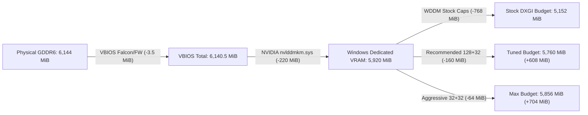

# Reverse-Engineering Windows 11 WDDM (`dxgmms2.sys`) & Reclaiming `+608–704 MiB` of Usable VRAM

On Windows 10 and Windows 11, a **6 GB GPU (`6,144 MiB`)** typically leaves games and CUDA/AI frameworks (`Ollama`, `llama.cpp`, `PyTorch`, `ComfyUI`) with only **`~5.03 GiB` (`5,152 MiB`)** of directly allocatable DXGI budget—even at `0 MiB` desktop usage. Over **`1.0 GiB` (`~17%`)** vanishes before a single model or game launches.

Disassembling Windows 11's Video Memory Manager (`C:\Windows\System32\drivers\dxgmms2.sys`) reveals that **`768 MiB`** of that loss comes from two WDDM safety caps—and that Microsoft compiled **retail `REG_DWORD` overrides** directly into `dxgmms2.sys` under:

```text
HKEY_LOCAL_MACHINE\SYSTEM\CurrentControlSet\Control\GraphicsDrivers\MemoryManager
```

> [!IMPORTANT]
> **100% Native Retail Configuration — Zero Kernel Patching:**
> Because these registry keys are parsed natively by `dxgmms2.sys` via `RtlQueryRegistryValues` at boot with no Test Signing or Kernel Debugger requirement, **Secure Boot, Driver Signature Enforcement (DSE), HVCI, Kernel Anti-Cheat (Vanguard / EAC / BattlEye), and Laptop S0 Modern Standby (`S0ix` + `RTD3`) remain 100% intact.**

---

## 1. Three Stages of VRAM Carve-Out on a 6 GB GPU

On a `6,144 MiB` card (such as an **RTX 4050 Laptop GPU**, **RTX 3060 Laptop GPU**, or **RTX 3050 6 GB**), VRAM is carved away in three distinct stages before DirectX 12 (`IDXGIAdapter3::QueryVideoMemoryInfo`) or CUDA (`cuMemGetInfo`) reports your usable budget:



### Stage A: VBIOS Hardware Carve-Out (`~3.5 MiB`)
Reserved by GPU bootROM / Falcon security microcontrollers (`WPR` / `FRTS`) before the OS boots (`6,144 MiB → 6,140.5 MiB` on Ada Lovelace). Cannot be altered in software.

### Stage B: GPU Kernel Driver Static `Reserved` (`~200–260 MiB` in `nvlddmkm.sys`)
Cross-referencing `nvlddmkm.sys` against NVIDIA's `open-gpu-kernel-modules` Resource Manager (`mem_mgr_gm107.c`, `mem_mgr_tu102.c`) shows this block funds:
1. **Windows WHQL Max-Context Reserve (`62.5 MiB`):** `memmgrGetMaxContextSize_TU102` pre-reserves `640 KB × 100` concurrent WDDM contexts.
2. **Lossless VRAM Compression Backing Store (`~24–36 MiB`):** Hardware `CompBit` tag cache covering all `6 GiB` of GDDR6.
3. **GPU MMU Page Tables (`~13–20 MiB`):** `4 KB` and `64 KB` Big-Page PTEs + Resizable BAR (`BAR1`) page directories.
4. **Graphics Engine (`GR`) Context & Preemption Buffers:** Per-GPC/TPC golden context images and `GFXP` preemption slots (which is why wider dies with more TPCs, like `GA106` RTX 3060 Laptop, reserve slightly more static driver VRAM than `GA107` RTX 3050 6 GB).
5. **GSP / PMU / FECS / GPCCS Firmware Heaps.**

### Stage C: Windows WDDM `dxgmms2.sys` Segment Budget Cut (`Up to 768 MiB`)
Even when Windows Task Manager shows **`5,920 MiB` (`5.8 GiB`)** of Dedicated GPU Memory, DirectX 12, Vulkan, and CUDA/WSL runtimes query **WDDM's `LOCAL` `Budget`**, which defaults to **`5,152 MiB`**—withholding **`768 MiB`** (`512 MiB + 256 MiB`).

---

## 2. Inside `dxgmms2.sys`: Exact Budget Formulas & Disassembly

Disassembling `VIDMM_GLOBAL::InitGlobals` and the segment budget calculator in Windows 11's `dxgmms2.sys` exposes the exact `RtlQueryRegistryValues` table read from `HKLM\SYSTEM\CurrentControlSet\Control\GraphicsDrivers\MemoryManager`.

### Dedicated (`LOCAL`) Segment Budget Formula
Given `Total = DedicatedVideoMemory` (e.g., `5,920 MiB`):

$$\text{FragBuffer} = \min\!\left(\left\lfloor\frac{\text{Total} \times \text{VideoMemoryFragmentationBuffer}}{100}\right\rfloor,\; \text{MaxVideoMemoryFragmentationBuffer}\right)$$

$$\text{ProcCapBuffer} = \min\!\left(\left\lfloor\frac{\text{Total} \times \text{ProcessBudgetCapBuffer}}{100}\right\rfloor,\; \text{MaxProcessBudgetCapBuffer}\right)$$

$$\text{DXGI Local Budget} = \text{Total} - \text{FragBuffer} - \text{ProcCapBuffer}$$

$$\text{AvailableForReservation} = \frac{\text{Total} - \text{FragBuffer}}{2}$$

> [!NOTE]
> Notice the `min(floor(Total * 10%), Max...)` structure:
> * Any discrete GPU with **`>= 5,120 MiB`** of Dedicated VRAM hits **both** stock ceilings (`512 MiB + 256 MiB = 768 MiB`), meaning a 6 GB laptop GPU loses the exact same `768 MiB` (`13%`) as a 24 GB RTX 4090 (`3.1%`).
> * On GPUs with **`< 5,120 MiB`** (e.g., a 4 GB card with `3,968 MiB` Dedicated VRAM), stock WDDM reserves `10% + 5% = 396 + 198 = 594 MiB`. Lowering the caps below `396` / `198` (e.g., `128 + 32 = 160 MiB`) still unlocks **`+434 MiB`**.
> * On **Integrated / UMA GPUs** (e.g., AMD Radeon 680M / Intel Iris Xe), DXGI places the unified DDR5 pool directly in `DXGI_MEMORY_SEGMENT_GROUP_LOCAL` and reports `0` budget in `NON_LOCAL`. Their ceiling is governed by `SystemPartitionCommitLimitPercentage` below.

### Undocumented `MemoryManager` Registry Keys (`dxgmms2.sys`)

| `REG_DWORD` Value Name | Unit | Stock Default | Kernel Clamp | Purpose in `VidMm` |
| :--- | :---: | :---: | :---: | :--- |
| `VideoMemoryFragmentationBuffer` | `%` | `10` | `0` – `50` | Percentage of Dedicated VRAM held back adapter-wide for GPU page tables & 64 KB defragmentation. |
| `MaxVideoMemoryFragmentationBuffer` | `MiB` | `512` | **`>= 32 MiB`** (`0x2000000`) | Upper cap in MiB on `FragBuffer`. |
| `ProcessBudgetCapBuffer` | `%` | `5` | `0` – `50` | Percentage of Dedicated VRAM withheld from any single foreground process so secondary apps (`dwm.exe`) fit. |
| `MaxProcessBudgetCapBuffer` | `MiB` | `256` | **`>= 32 MiB`** (`0x2000000`) | Upper cap in MiB on `ProcCapBuffer`. |
| `SystemPartitionCommitLimitPercentage` | `%` | `50` | `50` – `95` | Percentage of physical System RAM addressable as Shared GPU Memory (`NON_LOCAL` PCIe aperture on dGPUs / unified `LOCAL` pool on UMA iGPUs). |
| `SecondaryPartitionCommitLimitPercentage` | `%` | `50` | `50` – `95` | Matching commit limit percentage for secondary memory partitions. |

### Key Disassembly Excerpt (`dxgmms2.sys`, Windows 11 x64)
```nasm
; --- Defaults loaded prior to RtlQueryRegistryValues("GraphicsDrivers\MemoryManager") ---
140110d5d: mov    eax, 0x200                  ; Default MaxVideoMemoryFragmentationBuffer = 512 MiB
140110d65: mov    DWORD PTR [rsp+0x58], eax
140110d69: mov    eax, 0x100                  ; Default MaxProcessBudgetCapBuffer = 256 MiB
140110d71: mov    DWORD PTR [rsp+0x5c], eax
...
14011124a: lea    rdx, [rip - 0xaebef]        ; L"GraphicsDrivers\\MemoryManager"
140111251: lea    ecx, [rdi - 0x3]            ; RTL_REGISTRY_CONTROL (2)
140111269: call   QWORD PTR [rip - 0x84e98]   ; nt!RtlQueryRegistryValues

; --- Post-query MiB-to-Bytes shift and 32 MiB (0x2000000) minimum floor ---
14011134c: mov    ecx, 0x2000000              ; Minimum floor = 33,554,432 bytes (32 MiB)
140111382: mov    eax, DWORD PTR [rsp+0x58]   ; MaxVideoMemoryFragmentationBuffer
140111386: shl    rax, 0x14                   ; MiB -> Bytes (* 1,048,576)
14011138a: cmp    rax, rcx
140111393: cmovb  rax, rcx                    ; Clamp to >= 32 MiB
140111397: mov    [g_MaxVideoMemoryFragmentationBufferBytes], rax

14011139e: mov    eax, DWORD PTR [rsp+0x5c]   ; MaxProcessBudgetCapBuffer
1401113a2: shl    rax, 0x14                   ; MiB -> Bytes (* 1,048,576)
1401113a6: cmp    rax, rcx
1401113a9: cmovb  rax, rcx                    ; Clamp to >= 32 MiB
1401113ad: mov    [g_MaxProcessBudgetCapBufferBytes], rax
```

> [!TIP]
> **Why `MaxProcessBudgetCapBuffer = 32` is virtually free VRAM on Hybrid Laptops:**
> `ProcCapBuffer` (`256 MiB` default) exists to prevent one foreground game or AI process from starving background desktop processes on the same GPU. On an **MSHybrid / Optimus laptop**, `dwm.exe` and browsers render on the **iGPU**, leaving the discrete GPU dedicated to your heavy foreground workload.

---

## 3. Verified Before / After Measurements (Windows 11 Build `26300.9711`)

Measured post-reboot on **ASUS TUF Gaming A15 (`FA507NU`)** (`AMD Ryzen 7 7735HS` + `Radeon 680M` + `NVIDIA GeForce RTX 4050 Laptop GPU 6 GB`, `32 GB DDR5`):

| Metric (`RTX 4050 Laptop GPU`) | Stock Windows 11 | Recommended (`128 + 32`, `75%`) | Aggressive (`32 + 32`, `90%`) |
| :--- | :---: | :---: | :---: |
| **`nvidia-smi` Physical / VBIOS Total** | `6,141 MiB` | `6,141 MiB` | `6,141 MiB` |
| **Windows Dedicated Video Memory** | `5,920.00 MiB` | `5,920.00 MiB` | `5,920.00 MiB` |
| **WDDM `dxgmms2.sys` Reserve** | `768.00 MiB` | **`160.00 MiB`** | **`64.00 MiB`** |
| **DXGI `LOCAL` Usable `Budget`** | `5,152.00 MiB` (`5.03 GiB`) | **`5,760.00 MiB` (`5.63 GiB`)** | **`5,856.00 MiB` (`5.72 GiB`)** |
| **Net Dedicated VRAM Unlocked** | Baseline | **`+608.00 MiB`** | **`+704.00 MiB`** |
| **Shared System RAM Aperture** | `15,997 MiB` (`15.62 GiB`) | **`23,996 MiB` (`23.43 GiB`)** | **`28,795.42 MiB` (`28.12 GiB`)** |
| **S0 Modern Standby (`powercfg /a`)** | Active | **Active (`100% Intact`)** | **Active (`100% Intact`)** |

---

## 4. Safety Notes: Settings That Should Never Be Disabled on Laptops

Many third-party "debloat" scripts touch vendor-internal driver keys under `HKLM\SYSTEM\CurrentControlSet\Control\Class\{4d36e968-e325-11ce-bfc1-08002be10318}\0000` that **break Modern Standby or degrade performance**. `VRAMOptimizer.exe` intentionally **never** touches these:

* **Do NOT set `RmFbsrPagedDMA = 0` or `RmFbsrWDDMMode = 0`:** Frame Buffer Save/Restore evacuates VRAM to System RAM via Paged DMA before cutting dGPU power in `D3cold` / S0 sleep. Disabling it causes black screens on wake and `nvlddmkm` Event ID 153 resets.
* **Do NOT set `RMCompbitBackingSize = 0`:** Reclaims ~28 MiB at the cost of disabling hardware lossless VRAM compression (`-15%` to `-25%` GPU performance).
